# ambientCG: Metal Plates materials

**20 assets from [ambientCG](https://ambientcg.com), dedicated to the public domain under [CC0](https://docs.ambientcg.com/license/).** Use them in any game, free or paid, and change them however you like; no credit is needed.

PBR materials as 1K and 2K JPG maps (colour, normal GL and DX, roughness, AO, displacement), one folder per resolution. 420.0 MB in all.

This is a copy kept by [zuujis-cc0](https://github.com/zuujis-cc0) so game makers can take single files from GitHub. It is not made by or affiliated with ambientCG: the originals, often in more formats and higher resolutions, are on [ambientcg.com](https://ambientcg.com). If they help you, consider [supporting ambientCG](https://www.patreon.com/ambientCG).

Every file is listed in [MANIFEST.tsv](MANIFEST.tsv) with its size and SHA-256. More free assets: [the Zuujis collection](https://github.com/zuujis-cc0/free-game-assets#readme).

| | | | |
| :-: | :-: | :-: | :-: |
| <a href="MetalPlates001">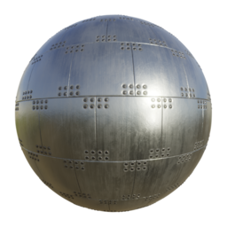</a> <b><a href="MetalPlates001">Metal Plates 001</a></b> by ambientCG · <a href="https://ambientcg.com/a/MetalPlates001">source</a> | <a href="MetalPlates002">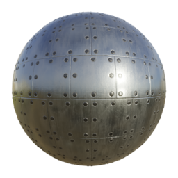</a> <b><a href="MetalPlates002">Metal Plates 002</a></b> by ambientCG · <a href="https://ambientcg.com/a/MetalPlates002">source</a> | <a href="MetalPlates003">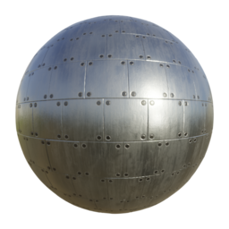</a> <b><a href="MetalPlates003">Metal Plates 003</a></b> by ambientCG · <a href="https://ambientcg.com/a/MetalPlates003">source</a> | <a href="MetalPlates004">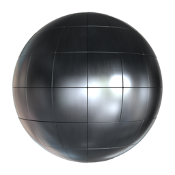</a> <b><a href="MetalPlates004">Metal Plates 004</a></b> by ambientCG · <a href="https://ambientcg.com/a/MetalPlates004">source</a> |
| <a href="MetalPlates005">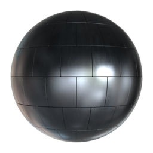</a> <b><a href="MetalPlates005">Metal Plates 005</a></b> by ambientCG · <a href="https://ambientcg.com/a/MetalPlates005">source</a> | <a href="MetalPlates006">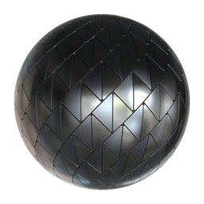</a> <b><a href="MetalPlates006">Metal Plates 006</a></b> by ambientCG · <a href="https://ambientcg.com/a/MetalPlates006">source</a> | <a href="MetalPlates007">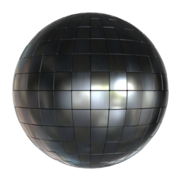</a> <b><a href="MetalPlates007">Metal Plates 007</a></b> by ambientCG · <a href="https://ambientcg.com/a/MetalPlates007">source</a> | <a href="MetalPlates008">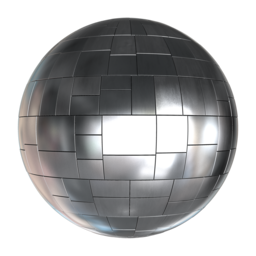</a> <b><a href="MetalPlates008">Metal Plates 008</a></b> by ambientCG · <a href="https://ambientcg.com/a/MetalPlates008">source</a> |
| <a href="MetalPlates009">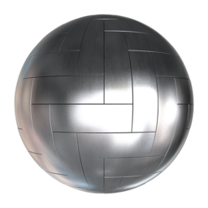</a> <b><a href="MetalPlates009">Metal Plates 009</a></b> by ambientCG · <a href="https://ambientcg.com/a/MetalPlates009">source</a> | <a href="MetalPlates010">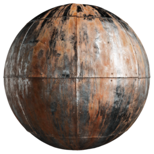</a> <b><a href="MetalPlates010">Metal Plates 010</a></b> by ambientCG · <a href="https://ambientcg.com/a/MetalPlates010">source</a> | <a href="MetalPlates011">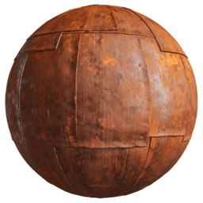</a> <b><a href="MetalPlates011">Metal Plates 011</a></b> by ambientCG · <a href="https://ambientcg.com/a/MetalPlates011">source</a> | <a href="MetalPlates012">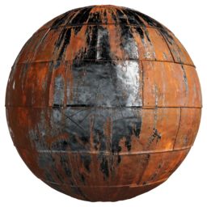</a> <b><a href="MetalPlates012">Metal Plates 012</a></b> by ambientCG · <a href="https://ambientcg.com/a/MetalPlates012">source</a> |
| <a href="MetalPlates013">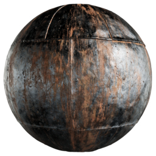</a> <b><a href="MetalPlates013">Metal Plates 013</a></b> by ambientCG · <a href="https://ambientcg.com/a/MetalPlates013">source</a> | <a href="MetalPlates014">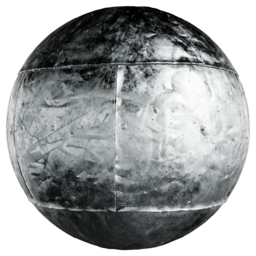</a> <b><a href="MetalPlates014">Metal Plates 014</a></b> by ambientCG · <a href="https://ambientcg.com/a/MetalPlates014">source</a> | <a href="MetalPlates015A">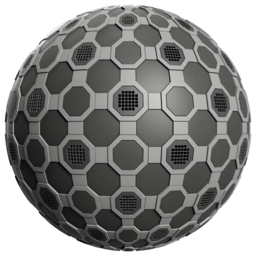</a> <b><a href="MetalPlates015A">Metal Plates 015 A</a></b> by ambientCG · <a href="https://ambientcg.com/a/MetalPlates015A">source</a> | <a href="MetalPlates015B">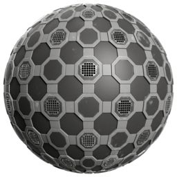</a> <b><a href="MetalPlates015B">Metal Plates 015 B</a></b> by ambientCG · <a href="https://ambientcg.com/a/MetalPlates015B">source</a> |
| <a href="MetalPlates016A">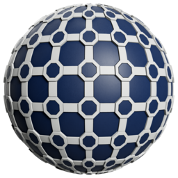</a> <b><a href="MetalPlates016A">Metal Plates 016 A</a></b> by ambientCG · <a href="https://ambientcg.com/a/MetalPlates016A">source</a> | <a href="MetalPlates016B">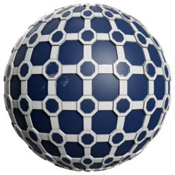</a> <b><a href="MetalPlates016B">Metal Plates 016 B</a></b> by ambientCG · <a href="https://ambientcg.com/a/MetalPlates016B">source</a> | <a href="MetalPlates017A">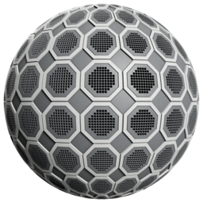</a> <b><a href="MetalPlates017A">Metal Plates 017 A</a></b> by ambientCG · <a href="https://ambientcg.com/a/MetalPlates017A">source</a> | <a href="MetalPlates017B">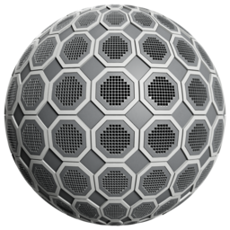</a> <b><a href="MetalPlates017B">Metal Plates 017 B</a></b> by ambientCG · <a href="https://ambientcg.com/a/MetalPlates017B">source</a> |

---

Kept up to date by this repository's own [update workflow](.github/workflows/update.yml), with code and plan from [cc0-mirror](https://github.com/zuujis-cc0/cc0-mirror). Something wrong? [Open an issue there](https://github.com/zuujis-cc0/cc0-mirror/issues/new) or use the [private report form](https://games.zuujis.com/report).
